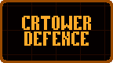

# CRTower Defence

A native tower-defence game for the **PlayStation Portable**, built in C with the
PSPSDK and rendered directly through the PSP Graphics Engine.

The game is a CRT-terminal take on the classic draw-your-own-path tower defence:
sketch the route, place towers along it, survive the waves, and pick a perk every
five waves. Every ten waves an enemy modifier is added to the run.

**Version:** 0.5 (pre-release)  
**Target:** PSP-2000 / PSP-3000, 480×272, 64 MB RAM  
**Folder on the memory stick:** `ms0:/PSP/GAME/CRTowerDefence/`



## Features

- Five tower types: Archer, Cannon, Frost, Sniper and Laser.
- Draw the enemy path yourself with the analog stick / D-pad.
- Endless waves with bosses and escalating enemy stats.
- A perk every 5 waves, including risky cursed perks.
- A new enemy modifier every 10 waves, announced with an in-game pop-up.
- Three CRT phosphor themes: amber, blue and green.
- Save / load directly from the pause menu.
- Pixel-crisp English UI with a hand-drawn proportional font.
- No bilinear filtering and no scanlines: clean, sharp 2D rendering.
- Batched GE renderer that splits large frames safely (no 65,535-vertex command
  overflow on heavy waves).

## Controls

| Input | Action |
| --- | --- |
| Analog / D-pad | Move cursor |
| Cross | Draw path point / place tower / select |
| Circle | Cancel / delete path point |
| Square | Toggle Draw ↔ Build mode |
| Hold Square | Sell selected tower |
| L / R | Change tower type |
| Triangle | Upgrade selected tower |
| Start | Start next wave |
| Select | Pause / help |

In the pause menu, select **Cursor Speed** and use **Left / Right** to adjust it.
**Perks & Mods** opens the active-run overview.

## Building

### Requirements

- [pspdev](https://github.com/pspdev/pspdev) with `psp-gcc`, PSPSDK and the
  PSP libraries.
- `make`.
- Linux, macOS, or Windows through WSL.

### Build

```bash
export PSPDEV="$HOME/pspdev"
export PATH="$PSPDEV/bin:$PATH"

make
# or: ./build.sh
```

The build produces `EBOOT.PBP` in the project root.

On Windows with WSL, use the provided script:

```powershell
MSYS_NO_PATHCONV=1 wsl.exe -d Ubuntu --exec bash "/mnt/c/path/to/CRTowerDefence/build.sh"
```

## Installing

Copy `EBOOT.PBP` to:

```text
ms0:/PSP/GAME/CRTowerDefence/EBOOT.PBP
```

For PPSSPP, the equivalent path is:

```text
Documents/PPSSPP/PSP/GAME/CRTowerDefence/EBOOT.PBP
```

The game creates `SAVE.BIN` next to the EBOOT. Saves are plain files rather than
`sceUtilitySavedata` data, because the native save dialog is unreliable on real
hardware. Saves from the earlier `PSTD` / `TowerDefence` folders are copied into
the new folder automatically the first time you save or load. Keep the old
folder in place until the new build has loaded once.

## Project layout

```text
src/
  main.c        PSP entry point and main loop
  game.c/.h     gameplay, waves, perks, modifiers, UI
  render.c/.h   immediate-mode GE 2D renderer and text
  audio.c/.h    sample synth / sound effects
  save.c/.h     plain-file save system
  font_data.h   generated font atlas and metrics
tools/
  build_font.py    rebuild src/font_data.h from font_english.png
  make_icon.py     rebuild ICON0.PNG
  run.ps1          deploy to PPSSPP and launch (Windows)
  sendkey.ps1      send keys to PPSSPP (Windows)
  screenshot.ps1   capture the PPSSPP window (Windows)
  drive.ps1        scripted PPSSPP test sequences
  scancode.ps1     key-map helper
ICON0.PNG         XMB icon
```

## Regenerating assets

```bash
python tools/build_font.py   # requires Pillow
python tools/make_icon.py    # requires Pillow
```

The font source is `tools/font_english.png`; digits and punctuation are drawn by
the script in the same 5×9 style.

## Credits

- Game design, original HTML version and art direction: **dude7ox**
- PSP port: built by **Deepseek 4.1 Flash** with the PSPSDK
- Font: hand-drawn Latin glyphs from the project's `font.png`

## License

MIT. See [LICENSE](LICENSE).
